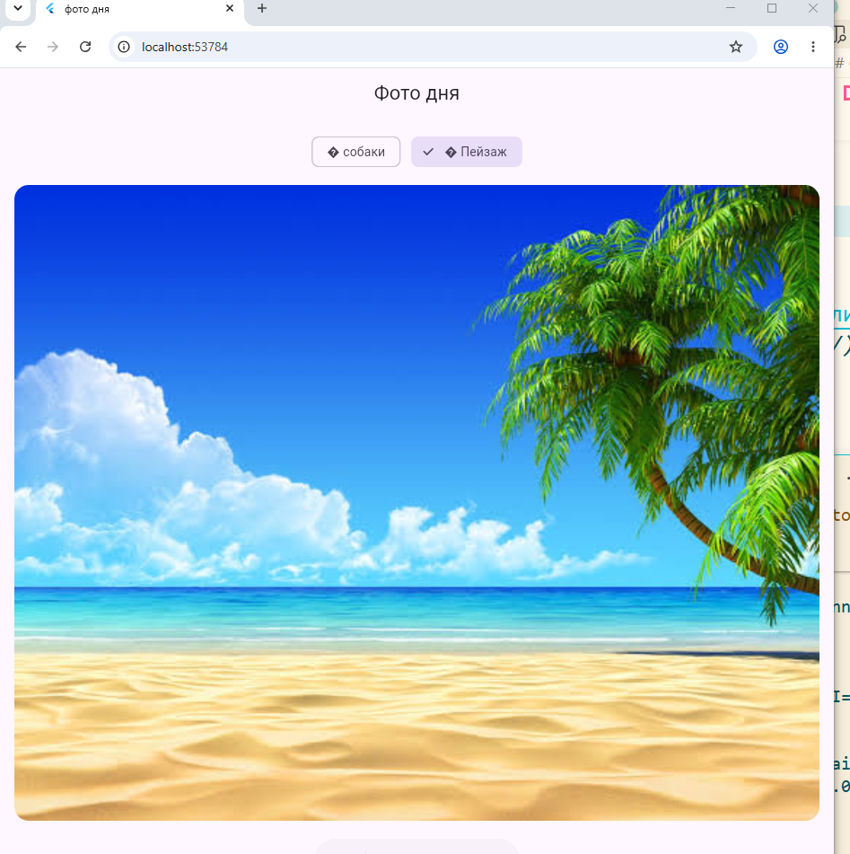

# Лабораторная работа №8. Асинхронность в Dart и Flutter.Создание приложения «Фото дня»

Flutter-приложение, которое по нажатию кнопки асинхронно загружает случайную
фотографию собаки или пейзажа

## автор

`Донскова Ульяна, группа ИСП-242`

## стек и версии

- **Flutter:** 3.41.1
- **Dart:** 3.11.0
- **Платформа:** Web (Chrome)
- **Пакет:** http ^1.6.0

## скриншот приложения

## как запустить

1. `git clone <url>`
2. `cd photo_of_the_day_fio`
3. `flutter pub get`
4. `flutter run -d chrome`

## что изучили

1. Future
2. async/await
3. поняли концепцию асинхронного программирования

## ответы на вопросы

1. `Future<T>` — это объект, который обещает вернуть значение типа T в будущем
   Отличие от обычного возвращаемого значения:

- обычное значение доступно сразу, в момент возврата из функции
- `Future<T>` — это не само значение, а «квитанция» на него: функция возвращает её мгновенно, а внутри лежит результат, которого пока может не быть. Если операция завершится ошибкой, Future вместо значения вернёт исключение

2. await ставится перед Future и означает: «дождись результата и подставь его значение» код после await выполнится только тогда, когда Future завершится
   Весь поток он не блокирует
3. Если второй вызов убрать, данные окажутся в переменных, но экран не перерисуется — Flutter не узнает, что что-то изменилось.если убрать первый — не будет видимой реакции на нажатие, и пользователь не поймёт, что идёт загрузка
4. Так мы передаём ссылку на функцию, а не результат её вызова. Кнопка запомнит эту ссылку и вызовет функцию только тогда, когда пользователь нажмёт на неё. Если написать `_fetchPhoto()` со скобками, функция выполнится немедленно в момент построения виджета — то есть фото начнёт грузиться само по себе при отрисовке экрана, а не по нажатию кнопки
5. `Image.network()` загружает картинку из интернета по URL — ей нужен доступ к сети, загрузка идёт асинхронно под управлением Flutter. `Image.asset()` показывает картинку из локальных ресурсов приложения — файлы лежат в папке assets/ и объявлены в pubspec.yaml, интернет не нужен, картинка появляется мгновенно
